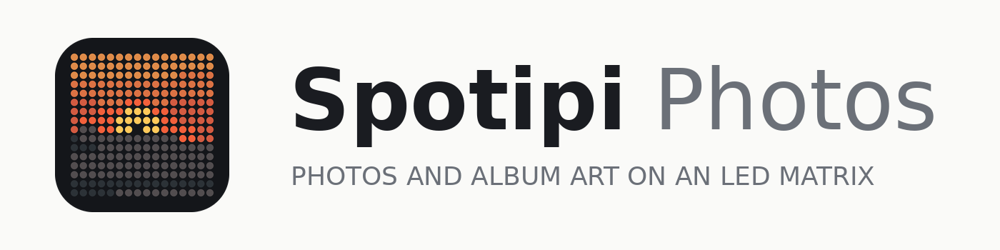

# spotipi-photos



Adds a **photo slideshow** to a Ryan Ward–style spotipi LED‑matrix build, with a rebuilt
**web control panel** (modes, live brightness, a *working* screen‑off timer, a daily
schedule and a sunrise/sunset dimmer). Album art takes over whenever Spotify is playing.

Photos get on in any of three ways, none of which exclude the others:

- **iPhone only** — a public iCloud Shared Album. Paste its link into the control panel and
  the Pi keeps itself in step with it. No Mac, no computer at all.
- **Any browser** — upload from the control panel. On an iPhone that opens the camera roll.
- **Mac** — a named Apple Photos album, mirrored every five minutes by `mac/sync_album.py`.

```
Mac (Apple Photos album)              any computer (a folder of pictures)
   │  sync_album.py                      │  tools/prepare_photos.py
   │  crop/resize + rsync --delete       │  crop/resize + scp or rsync
   └──────────────┬──────────────────────┘
                  ▼
Raspberry Pi  /home/pi/spotipi-photos/photos/
   │  displaySpotipi.py  — slideshow + Spotify priority, reads state.json live
   │  client/app.py      — web UI on :80, writes state.json
   ▼
RGB LED matrix — 64×64, 32×32 or 64×32
```

## Licence

Free and open source under the [MIT licence](LICENSE). This project is built on
[Spotipi](https://github.com/ryanwa18/spotipi) by Ryan Ward (MIT, copyright 2020).
His copyright notice is kept in `LICENSE`, as that licence requires.

## Why this fixes the broken screen‑off timer
The original web app turned the panel on/off by `systemctl start/stop`‑ing the display
service and *restarted* it on every brightness change. That makes timers and brightness
fragile. Here the **display daemon is always running** and re‑reads `config/state.json` every
loop. The web UI only writes that file — no service juggling — so brightness is live and the
timer is enforced reliably by the daemon itself.

## Documentation

| Document | For |
|---|---|
| [`docs/guides/SPOTIPI_BEGINNERS_GUIDE.md`](docs/guides/SPOTIPI_BEGINNERS_GUIDE.md) | Someone building this from nothing, who has never used a Pi. Every command in full, plus troubleshooting. |
| [`docs/guides/spotipi_assembly_guide.pdf`](docs/guides/spotipi_assembly_guide.pdf) | The hardware, in 8 illustrated pages. Print it and put it next to the parts. Source: `assembly_guide_source.py`. |
| [`HARDWARE.md`](HARDWARE.md) | What to buy and why, with dated prices, the power budget, and the Pi-model reasoning. |
| [`SPOTIFY_TOKEN_RENEWAL.txt`](SPOTIFY_TOKEN_RENEWAL.txt) | Re-doing the Spotify login, roughly every 6 months. |
| [`image/build_logo_assets.py`](image/build_logo_assets.py) | Regenerates both logos -- app icons, favicon, wordmark, panel splash -- from the photo artwork. |

The rest of this README is the quick version, for someone who already knows their
way around a Pi.

---

## Part A — Raspberry Pi (spotipi.local)

> Network note: you currently can't SSH to the Pi. Everything below assumes SSH/file access is
> restored. Until then you can copy `spotipi-photos/` onto the Pi with a USB stick or microSD.

1. Copy the `spotipi-photos/` folder to the Pi, e.g. `~/spotipi-photos`.
2. Create a Spotify developer app (free, no Premium needed) at
   <https://developer.spotify.com/dashboard> with redirect URI
   `http://127.0.0.1/callback`, then do the one-off login:
   ```bash
   cd ~/spotipi-photos
   bash generate-token.sh        # writes .cache-<username>
   ```
   *(Reuse your existing `.cache-<username>` from the current install if you have one.)*
   The full walkthrough, including where each credential comes from, is in the
   beginner's guide.
3. Install:
   ```bash
   cd ~/spotipi-photos
   sudo bash install_pi.sh
   ```
   It installs deps, asks for your Spotify username / token path / client id+secret / redirect
   URI, and creates two services:
   - `spotipi` → `python/displaySpotipi.py`
   - `spotipi-client` → `python/client/app.py` (web UI, port 80)

   If the Adafruit `rgbmatrix` driver isn't built on this Pi yet, `install_pi.sh` prints the
   commands to build it, then re-run it. (Adafruit replaced their old `rgb-matrix.sh` with a
   Python installer; the `.sh` URL that used to be quoted here now 404s.)
   `install_pi.sh` also sets `dtparam=audio=off`, which the matrix needs — the onboard audio
   and the panel share a timing circuit.
4. Open **http://spotipi.local** in any browser on your network.

Set your panel details in `config/rgb_options.ini` and `sudo systemctl restart spotipi`
after any change. **64×64, 32×32 and 64×32 panels are all supported** — set `rows` and
`columns` to match, and pass the same `--size` when you sync photos. `hardware_mapping`
stays `adafruit-hat` unless you have soldered the GPIO4→GPIO18 PWM jumper, in which case
use `adafruit-hat-pwm`. Raise `gpio_slowdown` if the panel tears.

### Controls (web UI)
- **Now on the panel** — a live dashboard at the top: a snapshot preview of what's
  actually on the matrix right now, the current song/artist or photo, a daemon
  health dot, and stats (photo count, brightness, last sync, timer left, CPU temp,
  uptime). Refreshes every few seconds.
- **On (auto)** — Spotify art while music plays, photo slideshow otherwise.
- **Off** — blank panel (daemon keeps running).
- **Photos only** / **Spotify only** — force one source.
- **Brightness** — live slider, 1–100, no restart. (This is the *daytime* level when the
  sunrise/sunset dimmer is on.)
- **Photo slideshow** — seconds per photo, plus a **Change photo** button to skip to the next
  photo immediately.
- **Screen timer** — turn the panel off after N minutes; the countdown restarts when you save
  it or tap a Display button.
- **Daily schedule** — recurring off window (handles overnight, e.g. 23:00→07:00).
- **Sunrise/sunset dimmer** — automatically drops to a lower night brightness between sunset
  and sunrise (times computed from your latitude/longitude — no internet or API key needed),
  and returns to the Brightness slider level during the day.

---

## Part B — getting photos on

Two routes, depending on what you own.

### B1 — Apple Photos, automatic (requires a Mac)

The Pi can't read your Mac's Photos library, so a small job runs on the Mac.

1. In **Apple Photos**, create an album named exactly **`Spotipi`** and add photos to it.
2. Install deps and set up SSH:
   ```bash
   cd spotipi-photos/mac
   bash install_mac.sh
   ssh-copy-id pi@spotipi.local      # passwordless SSH for rsync
   ```
3. Test it:
   ```bash
   python3 sync_album.py --dry-run    # shows what it would send
   python3 sync_album.py              # actually syncs
   ```
4. Automate every 5 minutes:
   - Edit `com.spotipi.albumsync.plist` — set the `python3` path, the full path to
     `sync_album.py`, and your album/host values.
   ```bash
   cp com.spotipi.albumsync.plist ~/Library/LaunchAgents/
   launchctl load ~/Library/LaunchAgents/com.spotipi.albumsync.plist
   ```

`sync_album.py` options: `--album`, `--pi-host`, `--pi-dir`, `--size`, `--ssh-port`, `--dry-run`.
Use `--size 32` for a 32×32 panel.

### B2 — any computer, manual (Windows, macOS, Linux)

`tools/prepare_photos.py` centre-crops and resizes a folder of pictures to the panel size and
copies them over. This matters because the display daemon scales images down but never crops
them, so an uncropped 4:3 photo arrives letterboxed.

```bash
python3 tools/prepare_photos.py ~/Pictures/forpanel --push pi@spotipi.local
python3 tools/prepare_photos.py ~/Pictures/forpanel --size 32       # 32x32 panel
python3 tools/prepare_photos.py ~/Pictures/forpanel                 # prepare only, prints the scp command
```

Needs `pillow` (and `pillow-heif` for iPhone `.HEIC` files). On Windows, `scp` ships with
Windows 10 and 11; WinSCP works too — the destination is `/home/pi/spotipi-photos/photos/`.

### How deletion sync works
`sync_album.py` rebuilds the full album as 64×64 PNGs in a temp folder, then
`rsync -av --delete` mirrors it to the Pi's `photos/` folder. `--delete` removes any file on
the Pi that's no longer in the album. Photos still in iCloud and not downloaded locally are
skipped with a warning — open them once in Photos to download.

---

## Automatic updates
`mac/auto_update.sh` (run by `com.spotipi.autoupdate.plist` every 6 hours) watches
`spotipi-photos-latest.zip` in the AI projects folder. When a new version appears it
pushes the code to the Pi, restarts the services, health-checks them, and rolls back
automatically if they fail to start. It never touches the Pi's live config, photos, or
token. One-time Pi setup is required so the Mac can restart the services without a
password prompt -- see spotipi-update.sudoers:
    sudo cp spotipi-update.sudoers /etc/sudoers.d/spotipi-update
    sudo chmod 440 /etc/sudoers.d/spotipi-update
Then on the Mac:
    cp mac/com.spotipi.autoupdate.plist ~/Library/LaunchAgents/
    launchctl load ~/Library/LaunchAgents/com.spotipi.autoupdate.plist
Log: /tmp/spotipi-update.log

## Files
```
spotipi-photos/
├── install_pi.sh              # Pi installer (creates systemd services)
├── generate-token.sh          # one-off Spotify login -> .cache-<username>
├── HARDWARE.md                # what to buy, and why
├── SPOTIFY_TOKEN_RENEWAL.txt  # how to refresh the Spotify token (~every 6 months)
├── README.md
├── config/
│   ├── rgb_options.ini        # matrix hardware (64×64 default)
│   ├── state.json             # live state written by the web UI
│   ├── default.png            # the default logo splash (Orange sunset)
│   ├── logos/                 # both logo splashes, 64 and 32 px; picked in the web UI
│   ├── spotipi.service        # display daemon unit
│   └── spotipi-client.service # web UI unit
├── python/
│   ├── displaySpotipi.py      # main display daemon
│   ├── display_logic.py       # pure mode/timer/schedule logic (tested)
│   ├── getSongInfo.py         # Spotify now-playing helper
│   ├── state.py               # atomic state.json read/write
│   ├── generateToken.py       # called by generate-token.sh
│   ├── icloud_album.py        # public iCloud Shared Album -> photos/
│   ├── icloudSync.py          # daemon: polls the album set in the web UI
│   └── client/
│       ├── app.py             # Flask web UI (port 80)
│       └── templates/index.html
├── photos/                    # mirror of the album (populated by the Mac)
├── mac/
│   ├── sync_album.py          # Apple Photos → Pi sync (Mac only)
│   ├── install_mac.sh
│   └── com.spotipi.albumsync.plist
├── tools/
│   └── prepare_photos.py      # crop/resize + copy, any OS
├── image/
│   ├── build_logo_assets.py   # regenerates everything below from the photo artwork
│   ├── stylise_candidates.py  # redraws a photo in the flat LP-sun style
│   ├── logos/sunset/, logos/dusk/  # each logo's icons, favicon, wordmark, splash
│   ├── icon.svg, icon-*.png, favicon.ico   # copies of the default (sunset)
│   └── wordmark.png, wordmark-dark.png
├── docs/guides/
│   ├── SPOTIPI_BEGINNERS_GUIDE.md
│   ├── spotipi_assembly_guide.pdf
│   └── assembly_guide_source.py
└── tests/
    └── test_logic.py
```

## Troubleshooting
- **Web UI loads but panel won't change** → `sudo systemctl status spotipi` and
  `journalctl -u spotipi -n 50`. Confirm the `rgbmatrix` driver is installed.
- **No Spotify art** → token/scope issue; the daemon falls back to `default.png`. Re‑run
  `generate-token.sh`. Needs scope `user-read-currently-playing user-read-playback-state`.
- **Photos not updating** → on the Mac check `/tmp/spotipi-albumsync.log` and that
  `ssh pi@spotipi.local` works without a password.
- **Panel flickers** → raise `gpio_slowdown` to 3 or 4 in `rgb_options.ini`, restart spotipi.


- **Panel blank / `Permission denied: state.json` or `default.png`** → the LED
  library drops root to the `daemon` user unless told not to. v1.2 sets
  `options.drop_privileges = False` in displaySpotipi.py so the daemon stays
  root. If you see this on an older copy, add that line before `RGBMatrix(...)`.
- **Web UI dead / `No module named flask`** → install a Python 3.7-compatible
  Flask:  `sudo python3 -m pip install "Flask==2.0.3" "Werkzeug==2.0.3"`.
- **Scheduled Mac sync finds 0 photos** → grant Full Disk Access to your
  python3 (add `/Library/Frameworks/Python.framework/Versions/<ver>/Resources/Python.app`
  via ⌘⇧G in the picker). Manual Terminal runs work without this.
